<p align="center"> <a href="https://loktrishal-portfolio.vercel.app"><picture><source media="(prefers-reduced-motion: reduce)" srcset="./assets/hero-cinematic.jpg">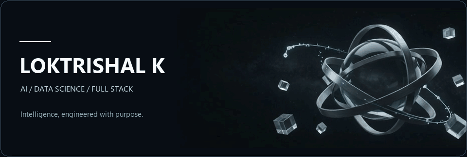</picture></a> 
</p>

<div align="center">

### Building intelligent systems. Making complex data useful.

**Chennai, India** · AI & Data Science · Full Stack Development

<a href="https://github.com/loktrishal-05?tab=followers"></a> <a href="https://github.com/loktrishal-05?tab=repositories"></a> <a href="#github-analytics">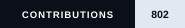</a>

<a href="https://loktrishal-portfolio.vercel.app"></a> <a href="https://www.linkedin.com/in/loktrishal-k-230294376/"></a> <a href="mailto:loktrishal.k@gmail.com"></a>

[Source motion (MP4)](./assets/orbit-source.mp4)

[About](#about-me) · [Projects](#featured-projects) · [Toolbox](#technical-toolbox) · [GitHub Analytics](#github-analytics) · [3D Contributions](#3d-contribution-landscape) · [Connect](#lets-connect)

</div>

---

## About me

<table>
<tr>
<td width="25%" align="center" valign="middle">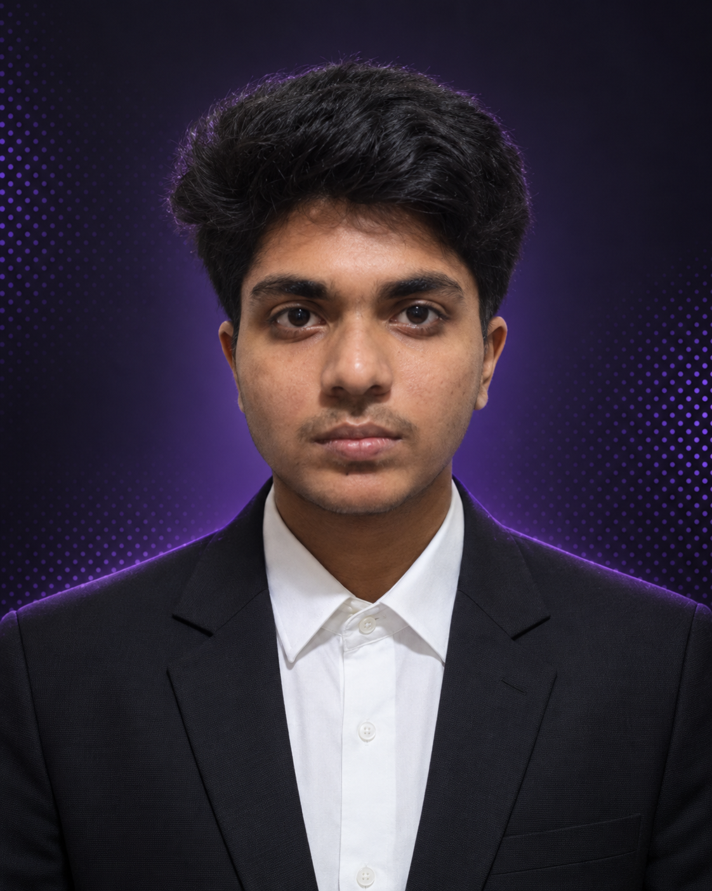</td>
<td width="75%" valign="middle">

### Loktrishal K
**AI & Data Science Engineer · Full Stack Developer**

Chennai, India

I connect machine learning, analytical modeling and thoughtful interfaces to build systems people can understand and use.

</td>
</tr>
</table>

- **AI & machine learning:** computer vision, classification, forecasting and grounded AI applications.
- **Data & analytics:** turning raw data into useful features, clear visualizations and evidence.
- **Full stack:** Python services, TypeScript interfaces, databases and deployment workflows.
- **Engineering values:** privacy, reproducibility, traceable decisions and human oversight.
- **Recent work:** healthcare education, agricultural agents, exoplanet detection and decision-support prototypes.

I enjoy the whole path from a difficult question to a working product: exploring the data, building the model, shaping the interface and testing how the pieces behave together.

<details>
<summary><b>A little more about how I work</b></summary>

```python
class Loktrishal:
    role = "AI & Data Science Engineer | Full Stack Developer"
    location = "Chennai, India"
    focus = ["Machine Learning", "Computer Vision", "Data Visualization"]
    build_with = ["Python", "TypeScript", "React", "FastAPI", "Flutter"]
    care_about = ["Privacy", "Evidence", "Clear Interfaces", "Human Oversight"]
    approach = "Understand → Build → Evaluate → Improve"
```

**What connects my projects:** useful intelligence, understandable outputs and clear boundaries between a demo, a model prediction and a real-world decision.

</details>

## Featured projects

<p><a href="https://github.com/loktrishal-05/kinsight">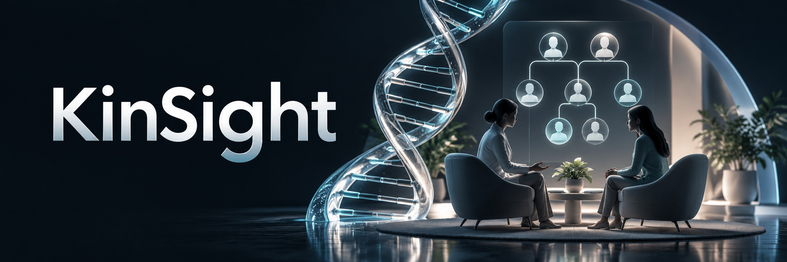</a></p>

**Next.js · TypeScript · Multilingual UI**

A multilingual navigator that explains inherited-risk screening in plain language and keeps genetic counselling in the loop. Built as a **fictional healthcare demo** with synthetic people and results.

[Explore source](https://github.com/loktrishal-05/kinsight) · [Try the demo](https://kinsight-five.vercel.app)

---

<p><a href="https://github.com/loktrishal-05/Solar-Da">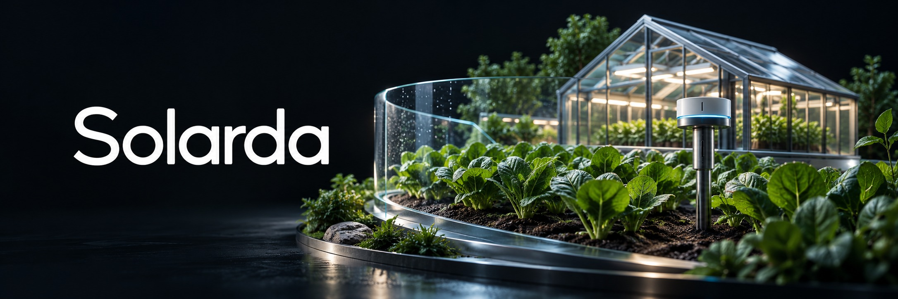</a></p>

**TypeScript · Python · Gemini · Docker**

Safety-gated farm agents, a multilingual assistant, plant-disease vision and sensor forecasting. Uses **replayed data** and a deterministic safety engine to check proposed actions.

[Explore source](https://github.com/loktrishal-05/Solar-Da) · [View the UI preview](https://solarda.vercel.app)

---

<p><a href="https://github.com/loktrishal-05/exoplanet-detection">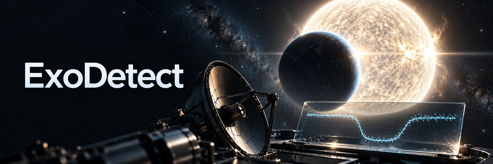</a></p>

**Python · XGBoost · ONNX**

Exoplanet candidate detection from noisy Kepler light curves, using transit features and a calibrated classifier. Built for **ISRO Bhartiya Antariksh Hackathon 2026**.

[Explore source](https://github.com/loktrishal-05/exoplanet-detection) · [Try the demo](https://exodetect-isro-bah.netlify.app)

---

<p><a href="https://github.com/loktrishal-05/legal-compliance-regulatory-workbench"></a></p>

**FastAPI · React · PostgreSQL**

Contract intelligence, regulatory change and compliance workflows connecting documents, interpretations and accountable decisions. **In development**, with source checkpoints documented.

[Explore source](https://github.com/loktrishal-05/legal-compliance-regulatory-workbench) · [Read the architecture](https://github.com/loktrishal-05/legal-compliance-regulatory-workbench#system-design)

---

<p><a href="https://github.com/loktrishal-05/ertmac-nwis">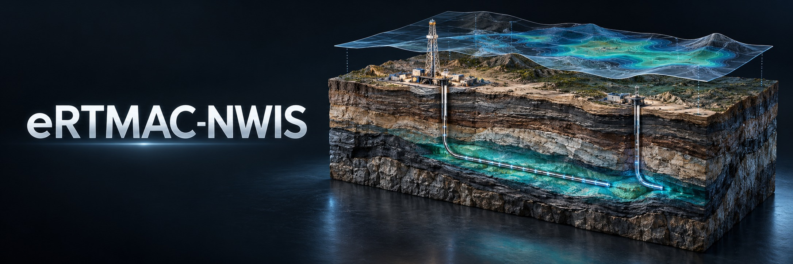</a></p>

**FastAPI · React · PostGIS · LangGraph**

Nearby-well intelligence and advisory drilling support. The prototype uses **synthetic data and replayed telemetry**, with a human decision-maker.

[Explore source](https://github.com/loktrishal-05/ertmac-nwis) · [Read the prototype scope](https://github.com/loktrishal-05/ertmac-nwis#-problem)

---

<p><a href="https://github.com/loktrishal-05/EduNova">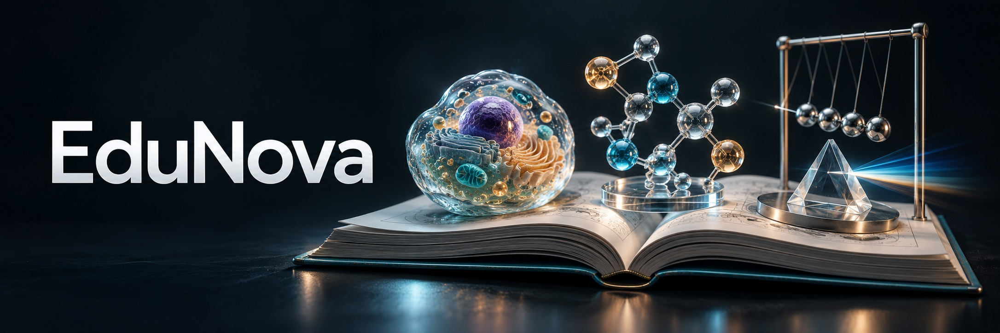</a></p>

**Next.js · Three.js · React Three Fiber · GSAP**

A gamified science-learning platform with biology, chemistry and physics worlds, 3D visuals, video quests and learning-progress interfaces.

[Explore source](https://github.com/loktrishal-05/EduNova) · [Visit the project](https://edu-nova-dun.vercel.app)


<details>
<summary><b>More projects: healthcare web, analytics and creative development</b></summary>

| Project | What I built | Explore |
|:--|:--|:--|
| **Sri Ambal Healthcare** | A hospital website with appointment booking, doctor information and an AI chatbot. | [Source](https://github.com/loktrishal-05/sri-ambal-healthcare) · [Website](https://sri-ambal-healthcare.vercel.app) |
| **Power BI** | A repository for data visualization work and a Power BI report. | [View repository](https://github.com/loktrishal-05/power-bi) |
| **3D Portfolio** | My personal portfolio, built with Three.js, GSAP and JavaScript. | [Source](https://github.com/loktrishal-05/loktrishal-portfolio) · [Explore in 3D](https://loktrishal-portfolio.vercel.app) |

</details>

<details>
<summary><b>Explore projects by domain</b></summary>

- **Healthcare & education:** [KinSight](https://github.com/loktrishal-05/kinsight), [Sri Ambal Healthcare](https://github.com/loktrishal-05/sri-ambal-healthcare), [EduNova](https://github.com/loktrishal-05/EduNova).
- **Agents & decision support:** [Solarda](https://github.com/loktrishal-05/Solar-Da), [Legal Assurance](https://github.com/loktrishal-05/legal-compliance-regulatory-workbench), [NWIS](https://github.com/loktrishal-05/ertmac-nwis).
- **Science & visualization:** [ExoDetect](https://github.com/loktrishal-05/exoplanet-detection), [Power BI](https://github.com/loktrishal-05/power-bi), [3D Portfolio](https://loktrishal-portfolio.vercel.app).

</details>

## Technical toolbox

### 💻 Languages & App Development

<p>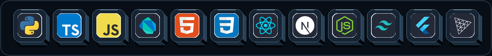</p>

### 🧠 AI, Data & APIs

<p>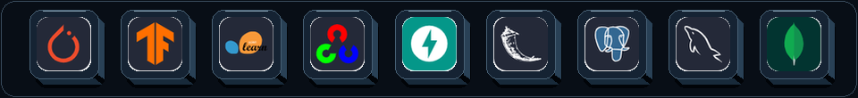</p>

**Analytics & AI tools:** Power BI · Pandas · NumPy · Jupyter · Gemini

### ☁️ Cloud, Delivery & Design

<p></p>

## GitHub analytics

<picture>
  <source media="(max-width: 600px)" srcset="https://raw.githubusercontent.com/loktrishal-05/loktrishal-05/output/dashboard-mobile.svg">
  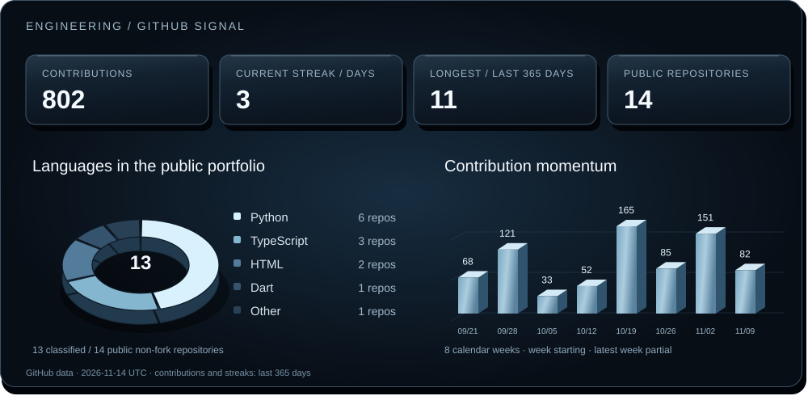
</picture>

**Live GitHub data, refreshed daily.** The ring counts primary languages across public non-fork repositories. Streaks cover the last 365 days in UTC; the latest contribution week is partial.

<picture>
  <source media="(max-width: 600px)" srcset="https://raw.githubusercontent.com/loktrishal-05/loktrishal-05/output/cards/analytics-depth-mobile.svg">
  
</picture>

<details>
<summary><b>Full metrics and contribution timeline</b></summary>

<picture>
  <source media="(max-width: 600px)" srcset="https://raw.githubusercontent.com/loktrishal-05/loktrishal-05/output/cards/metrics-depth-mobile.svg">
  
</picture>

<p></p>

</details>


## 3D contribution landscape

<p align="center">
<picture>
  <source media="(prefers-color-scheme: light)" srcset="https://raw.githubusercontent.com/loktrishal-05/loktrishal-05/output/profile-3d-contrib/profile-starlight-light.svg"> 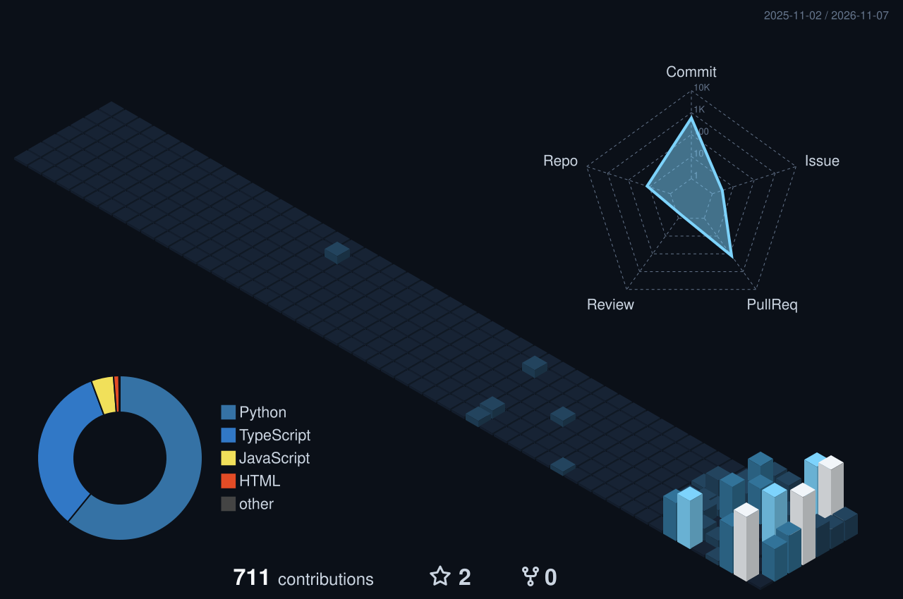
</picture>
</p>

<div align="center"><sub>A growing 3D view of my contribution history · adapts to your GitHub light or dark theme</sub></div>

## Contribution snake

<picture>
  <source media="(prefers-color-scheme: dark)" srcset="https://raw.githubusercontent.com/loktrishal-05/loktrishal-05/output/github-snake-dark.svg">
  <source media="(prefers-color-scheme: light)" srcset="https://raw.githubusercontent.com/loktrishal-05/loktrishal-05/output/github-snake.svg"> 
</picture>

## Recent public activity

<!--START_SECTION:activity-->
1. 🎉 Merged PR [#1](https://github.com/loktrishal-05/loktrishal-portfolio-cinematic/pull/1) in [loktrishal-05/loktrishal-portfolio-cinematic](https://github.com/loktrishal-05/loktrishal-portfolio-cinematic)
2. 🗣 Commented on [#1](https://github.com/loktrishal-05/loktrishal-portfolio-cinematic/pull/1#issuecomment-6596873345) in [loktrishal-05/loktrishal-portfolio-cinematic](https://github.com/loktrishal-05/loktrishal-portfolio-cinematic)
3. 💪 Opened PR [#1](https://github.com/loktrishal-05/loktrishal-portfolio-cinematic/pull/1) in [loktrishal-05/loktrishal-portfolio-cinematic](https://github.com/loktrishal-05/loktrishal-portfolio-cinematic)
4. 🎉 Merged PR [#78](https://github.com/Harsha-code-per/Cadence/pull/78) in [Harsha-code-per/Cadence](https://github.com/Harsha-code-per/Cadence)
5. 🎉 Merged PR [#77](https://github.com/Harsha-code-per/Cadence/pull/77) in [Harsha-code-per/Cadence](https://github.com/Harsha-code-per/Cadence)
<!--END_SECTION:activity-->

<sub>Activity, contribution graphics and streaks refresh automatically through GitHub Actions.</sub>

---

## Let's connect

I'm interested in conversations about **AI applications, data visualization, full stack engineering and thoughtful product experiences**.

<div align="center">

<a href="https://www.linkedin.com/in/loktrishal-k-230294376/"></a> <a href="mailto:loktrishal.k@gmail.com"></a> <a href="https://loktrishal-portfolio.vercel.app"></a>
</div>

<p align="left"><a href="https://loktrishal-portfolio.vercel.app">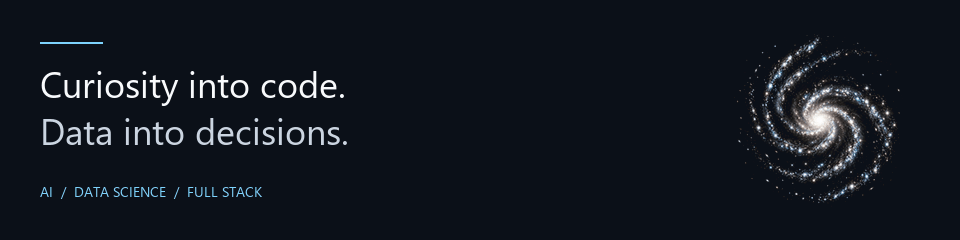</a></p>

[Back to the top](#)
